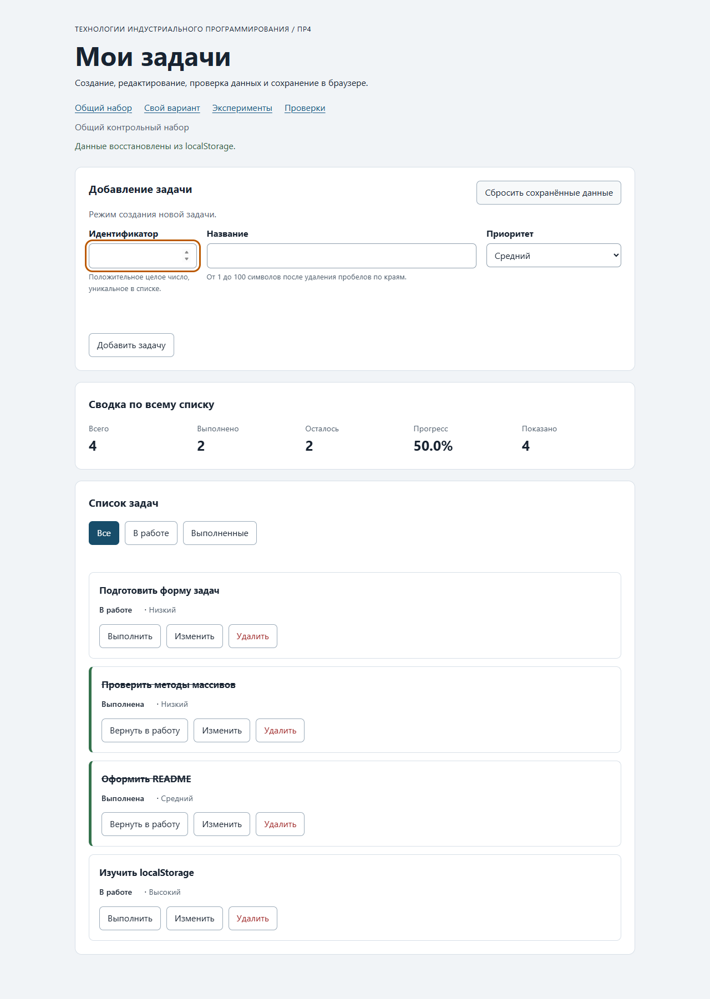

# Практическая работа №4. Формы, валидация и локальное хранение данных

Автор: Соколов Григорий Александрович. Группа: ЭФБО-12-25.
Номер по журналу: 18. Учебный вариант: **2**, по формуле `((18 - 1) % 8) + 1`.
Дата проверки: 16.11.2026.

Окружение: Windows, Node.js **v24.22.3** (отдельный переносной runtime) и **v26.13.1** (системный), npm **11.20.0**, Microsoft Edge **157.0.4341.60**.
Все готовые проверки и собственные Node.js-проверки прошли на обеих версиях Node.js.
Браузерные проверки выполнены в настоящем Edge без видимого окна; API и статический сервер запускались локально.
Исходная установка Node.js не изменялась. Для воспроизведения курса рекомендуется Node.js 24.

Условие: [ЗАДАНИЕ.md](ЗАДАНИЕ.md). Зависимости приложения устанавливать не требуется.

## Запуск

Открыть терминал в `D:\ЗАДАНИЯ ИЗ ВУЗА\ТИПы\practice-04`:

```powershell
npm.cmd test
npm.cmd start
```

Общий набор: http://127.0.0.1:5504/ . Вариант: http://127.0.0.1:5504/?dataset=variant .
Браузерные проверки: http://127.0.0.1:5504/checks.html . Эксперименты: http://127.0.0.1:5504/examples/forms-storage.html .
При проверке сохранения нельзя менять origin: `localhost` и `127.0.0.1`, как и разные порты, имеют разные хранилища.

Остановка: Ctrl+C в терминале сервера. Для запуска двойным щелчком предусмотрен `Запустить.cmd`.

## Цель и устройство

Реализован список задач с формой создания и редактирования, фильтрами, сменой статуса, удалением,
сводкой и восстановлением данных после обновления страницы.
Предыдущие решения ПР2–ПР3 в эту папку не предоставлялись: совместимая сервисная и DOM-основа
реализована заново по их контрактам. Это не фиктивный перенос существующего кода.

| Модуль | Ответственность |
|---|---|
| `data.js` | Неизменяемые при работе исходные demo и variant |
| `task-service.js` | Создание, поиск, статистика, неизменяемые операции, новый `updateTask` |
| `task-selectors.js` | Выбор видимых задач без изменения исходного массива |
| `task-view.js` | Карточки и сводка; пользовательский текст через `textContent` |
| `form-validation.js` | Проверка и нормализация черновика, сбор ошибок всех полей |
| `task-storage.js` | JSON, версия 1, проверка схемы, fallback и ошибки доступа |
| `main.js` | Состояние, режим формы, события и координация модулей |

Поток: `submit → FormData → validateTaskDraft → addTask/updateTask → saveTasks → renderApp`.
В режиме редактирования id берётся из `editingId`, поскольку disabled-поле отсутствует в FormData.
`updateTask` меняет только название и приоритет, сохраняя статус. Ошибки формы очищаются по полям на `input`.
Чистая отрисовка не пишет в storage. Ошибка сохранения не уничтожает текущие изменения в памяти.

## Эксперименты с формой и JSON

Фактические значения записаны в [observations.json](verification/observations.json).
Таблица содержит объяснение ожидаемого поведения и отдельно результат контрольного запуска;
она не выдаётся за личный прогноз автора, сделанный до разработки.

| Сценарий | Ожидание | Факт |
|---|---|---|
| Пустое required-поле | Браузер блокирует submit | Счётчик submit = 0, validity.valid = false |
| Название из пробелов | HTML пропускает, прикладная проверка отклоняет | Обработчик вызван, показана ошибка |
| Корректное название с пробелами | trim; отмена отправки; строки FormData | defaultPrevented=true; тип title — string; сохранено «Доклад» |
| Чтение JSON | getItem возвращает строку, parse — объект | Восстановлены title «Доклад» и priority low |
| Повреждённый JSON | Исключение должно быть перехвачено | Учебная страница показала ошибку JSON.parse |

## Проверка формы и восстановления

| Проверка | Ожидаемый результат | Фактический результат |
|---|---|---|
| Корректное добавление | Новый id в конце, название нормализовано | Пройдено в браузере и Node.js |
| Дубликат id | Ошибка поля, нет записи старых данных | Список и storage не изменились |
| Пустое название и пробелы | Отказ | Пройдено |
| Длина 100 и 101 | 100 принимается, 101 отклоняется | Пройдено модульными проверками |
| Редактирование выполненной задачи | Статус сохраняется | Пройдено |
| Отмена редактирования | Пустая форма создания, фокус на id | Пройдено, включая Enter на кнопке |
| Отсутствующий ключ | Независимая копия исходных данных | Пройдено |
| Верная запись | Восстановление после перезагрузки | Пройдено в настоящем браузере |
| Повреждение JSON/версии/задачи | Предупреждение и fallback целиком | Пройдено |
| Исключения getItem/setItem/removeItem | Управляемый результат | Пройдено модульными проверками |
| Сброс | Удаляется один ключ, восстановлен исходный список | Ключ demo отсутствует после сброса |
| Раздельные наборы | Данные demo и variant не смешиваются | Пройдено |

## Общий контрольный сценарий

| Шаг | Ожидаемые id | Фактические id | Всего | Выполнено | Осталось | Прогресс |
|---|---|---|---:|---:|---:|---|
| Сброс / исходный набор | `[1, 4, 7, 10]` | `[1, 4, 7, 10]` | 4 | 2 | 2 | 50.0% |
| Добавить 20 | `[1, 4, 7, 10, 20]` | `[1, 4, 7, 10, 20]` | 5 | 2 | 3 | 40.0% |
| Отказ для дубликата 4 | `[1, 4, 7, 10, 20]` | `[1, 4, 7, 10, 20]` | 5 | 2 | 3 | 40.0% |
| Изменить 4: Подготовить форму задач, low | `[1, 4, 7, 10, 20]` | `[1, 4, 7, 10, 20]` | 5 | 2 | 3 | 40.0% |
| Завершить 7 | `[1, 4, 7, 10, 20]` | `[1, 4, 7, 10, 20]` | 5 | 3 | 2 | 60.0% |
| Удалить 1 | `[4, 7, 10, 20]` | `[4, 7, 10, 20]` | 4 | 2 | 2 | 50.0% |
| Перезагрузить | `[4, 7, 10, 20]` | `[4, 7, 10, 20]` | 4 | 2 | 2 | 50.0% |
| Сбросить | `[1, 4, 7, 10]` | `[1, 4, 7, 10]` | 4 | 2 | 2 | 50.0% |

После перезагрузки выведено сообщение о восстановлении из localStorage.
Сохранённый формат — `{ "version": 1, "tasks": [...] }`; после окончательного сброса ключ удалён.

## Индивидуальный вариант

Тема: подготовка выступления. Исходные id: `[11,23,37,41,58,64]`.
Первоначально выполнена только задача 11. Исходные названия и приоритеты находятся в `src/data.js`;
в наборе присутствуют все три приоритета.

| Шаг | Ожидание | Фактические id | Всего | Выполнено | Прогресс |
|---|---|---|---:|---:|---|
| Исходный набор | 6 задач, 1 выполненная, 16.7% | `[11, 23, 37, 41, 58, 64]` | 6 | 1 | 16.7% |
| Добавить 75, medium | 7 задач, 1 выполненная, 14.3% | `[11, 23, 37, 41, 58, 64, 75]` | 7 | 1 | 14.3% |
| Изменить 23, high | 7 задач, 1 выполненная, 14.3% | `[11, 23, 37, 41, 58, 64, 75]` | 7 | 1 | 14.3% |
| Удалить 37 | 6 задач, 1 выполненная, 16.7% | `[11, 23, 41, 58, 64, 75]` | 6 | 1 | 16.7% |
| Перезагрузка | 6 задач, 1 выполненная, 16.7% | `[11, 23, 41, 58, 64, 75]` | 6 | 1 | 16.7% |
| Сброс | 6 задач, 1 выполненная, 16.7% | `[11, 23, 37, 41, 58, 64]` | 6 | 1 | 16.7% |

На шагах с семью задачами ожидается 14.3%; при шести задачах — 16.7%.
Общий набор после индивидуальных операций остался `[1,4,7,10]`. После сброса варианта восстановлены исходные шесть задач.

## Собственные случаи

1. Название из 100 букв с двумя пробелами по краям: после trim длина 100, данные приняты.
2. Два полных цикла сохранения и чтения: второй цикл восстанавливает новое значение completed, исходный объект не изменён.
3. Одна задача с неизвестным приоритетом в сохранённом массиве: отклонена вся запись, получена независимая копия fallback.

## Отладка и клавиатура

Через Chrome DevTools Protocol установлены настоящие точки останова в `handleFormSubmit`:
перед проверкой черновика, после проверки и после сервисной операции.
Для id «20» зафиксированы строковый draft.id, title с внешними пробелами, затем числовой id=20
и title без этих пробелов. После addTask список содержит пять задач.
Для повторного id=4 зафиксирован `ok:false` и непустая `errors.id`; сервис и запись не выполняются.
Подробный снимок переменных и JSON — поле `debug4` файла observations.json.
Проверено: Tab переводит фокус с id на название; начало редактирования фокусирует название;
Enter на отмене возвращает фокус на id. Кнопки являются нативными button и доступны с клавиатуры.

## Протоколы проверок

Готовые Node.js: **35 + 27 = 62/62**. Собственные: **3/3**. Браузер: **23/23**.

Полный фактический вывод: [Node.js 24](verification/node.txt), [Node.js 26](verification/node26.txt).
Собственные сценарии находятся в `checks/own.checks.js` и входят в `npm.cmd test`.

[Полный браузерный протокол](verification/browser.txt).



## Ответы на контрольные вопросы

1. **Почему submit, а не только click?** submit охватывает и кнопку, и отправку с клавиатуры.

2. **Что делает preventDefault?** Отменяет стандартную отправку; выполнение обработчика и распространение события сами по себе не прекращаются.

3. **Какие значения даёт FormData?** Для обычных полей — строки; отсутствующее поле при get даёт null. Файловые поля могут содержать File.

4. **Почему нет disabled id?** Отключённые контролы не включаются в FormData; используем editingId.

5. **Где граница HTML-проверки?** HTML проверяет required/min/step/maxlength, модель — нормализованное название, уникальность id и допустимые значения.

6. **Почему required допускает пробелы?** Строка непустая до trim.

7. **Зачем setCustomValidity и reportValidity?** Первый задаёт/очищает прикладную ошибку, второй проверяет форму и показывает сообщение браузера.

8. **Почему валидатор не обращается к DOM?** Это чистая проверяемая функция, пригодная вне браузера.

9. **Как различаются режимы?** editingId=null — создание; существующий числовой id — редактирование.

10. **Почему сохраняется completed?** Редактирование title/priority не является сменой статуса.

11. **Что хранит localStorage?** Строковые ключи и значения; массив сериализуется в JSON.

12. **Нет ключа или запись повреждена?** Нет ключа — нормальный initial; повреждение — fallback с предупреждением.

13. **Почему JSON.parse недостаточно?** Он проверяет синтаксис JSON, но не поля модели, типы, версию и уникальность id.

14. **Зачем version?** Чтобы отличать поддерживаемый формат сохранения от другого формата.

15. **Почему отклоняется весь список?** Частичное молчаливое восстановление скрывало бы потерю данных и нарушало целостность набора.

16. **Зачем передавать storage?** Явная зависимость позволяет подменить хранилище в тестах и моделировать исключения.

17. **Что при ошибке setItem?** Возвращается ok:false; текущий список остаётся в памяти, показывается предупреждение.

18. **Почему renderApp не сохраняет?** Повторная отрисовка и фильтрация не являются изменениями модели.

19. **Почему фильтр и режим не сохраняются?** В обязательной схеме хранятся задачи; временное состояние интерфейса не входит в неё.

20. **Почему два ключа наборов?** Чтобы изменения общего и индивидуального набора были независимы.

21. **Зачем отдельный namespace проверок?** Чтобы автопроверки не меняли пользовательские записи.

22. **Чем removeItem безопаснее clear?** Удаляет один ключ вместо всех данных этого origin.

23. **Почему важен порт?** Порт входит в origin, определяющий область хранилища.

24. **Что ещё проверять вручную?** Фокус, клавиатуру, читаемость и понятность сообщений в своём браузере, собственный вариант и сценарии вне тестов.

## Дополнительное задание и вывод

Необязательные расширения (черновик формы или синхронизация вкладок) не добавлялись.
Обязательная часть выполнена: модель проверяется отдельно от интерфейса, сохранение и восстановление устойчивы к повреждениям,
изменение названия не сбрасывает статус, наборы изолированы.
