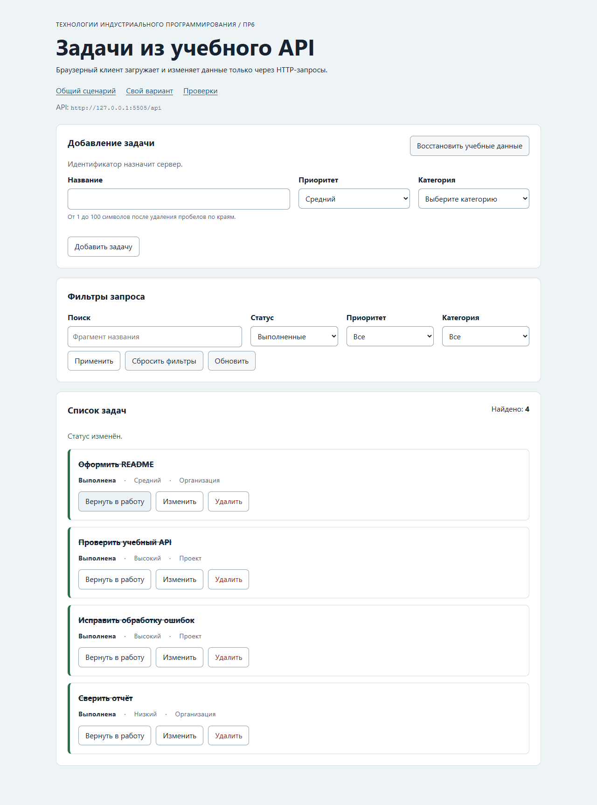
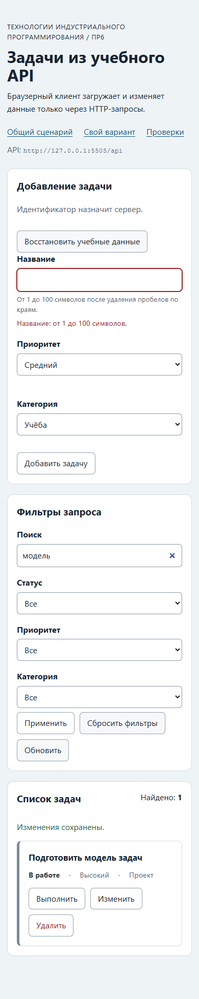

# Практическая работа №6. Подключение браузерного приложения к API

Автор: Соколов Григорий Александрович. Группа: ЭФБО-12-25.
Номер по журналу: 18. Учебный вариант: **2**, по формуле `((18 - 1) % 8) + 1`.
Дата проверки: 16.11.2026.

Окружение: Windows, Node.js **v24.22.3** (отдельный переносной runtime) и **v26.13.1** (системный), npm **11.20.0**, Microsoft Edge **157.0.4341.60**.
Все готовые проверки и собственные Node.js-проверки прошли на обеих версиях Node.js.
Браузерные проверки выполнены в настоящем Edge без видимого окна; API и статический сервер запускались локально.
Исходная установка Node.js не изменялась. Для воспроизведения курса рекомендуется Node.js 24.

Условие: [ЗАДАНИЕ.md](ЗАДАНИЕ.md). Зависимости приложения устанавливать не требуется.

## Запуск

Открыть терминал в `D:\ЗАДАНИЯ ИЗ ВУЗА\ТИПы\practice-06`:

```powershell
npm.cmd test
npm.cmd start
```

Одна команда поднимает API и статический сервер. Приложение: http://127.0.0.1:5506/ .
Вариант: http://127.0.0.1:5506/?dataset=variant . Проверки: http://127.0.0.1:5506/checks.html .
API: http://127.0.0.1:5505/api . Перед запуском остановить API ПР5, если он занимает 5505.
Задачи хранятся в памяти сервера: обновление браузера их сохраняет, перезапуск API восстанавливает исходный набор.

Остановка: Ctrl+C в терминале сервера. Для запуска двойным щелчком предусмотрен `Запустить.cmd`.

## Цель и реализация

Реализован браузерный клиент CRUD для готового API без фреймворков.
`api-client.js` расширяет клиент ПР5 методами POST/PATCH/DELETE, сериализацией тела и ответом 204.
`task-api.js` выбирает маршруты и проверяет схемы. `form-validation.js` нормализует название и categoryId,
проверяет приоритет и наличие категории. `task-view.js` создаёт безопасные DOM-карточки.
`app-controller.js` управляет асинхронным состоянием через переданный адаптер view.
Предоставленные `dom-app.js` и `main.js` соединяют контроллер с формой и делегированными событиями.
Готовый сервер, HTML и CSS не переписывались.

Все запросы идут через общий HTTP-клиент; контроллер не использует fetch или document.
Сервер назначает id и completed при создании. Для каждого успешного изменения выполняется повторный GET
с актуальными фильтрами; локальная копия — только снимок ответа API, не источник истины.
Неверная форма не отправляет запрос. Ошибки HTTP не маскируются под network.
Ответ 204 возвращает null до JSON-разбора. Поля формы проверяются до вызова API,
но серверная проверка остаётся обязательной: прямой некорректный вызов API возвращает структурированную HTTP-ошибку 400.

## Состояния и конкурентные запросы

`loading → ready | empty | error`. При повторе после неудачной первой загрузки снова запрашиваются
задачи вместе с категориями. Успешная пустая выборка — отдельное состояние empty.
Ошибки не затирают последнюю копию данных в контроллере.

Перед загрузкой предыдущий AbortController отменяется; номер sequence увеличивается.
Ответ применяется только при совпадении номера и отсутствии отмены/destroy.
Это защищает и от источников, которые проигнорировали AbortSignal.
Отмена не показывается как ошибка. При мутации кнопки заблокированы; повторный submit подавляется.
Блокировка снимается в finally, в том числе после ошибки. После destroy поздняя мутация не меняет представление.

## Индивидуальный вариант

Вариант 18 → 2. Начальный запрос: `GET /api/tasks?completed=true`.
До действия ожидаются и фактически получены id `[1,10,16,25,31]`.
Задача 1 возвращена в работу. Записана реальная последовательность:

```text
PATCH /api/tasks/1 → 200
GET /api/tasks?completed=true → 200
```

После действия ожидаются и получены `[10,16,25,31]`: задача 1 больше не соответствует фильтру.
Запросы и статусы сохранены в `verification/observations.json`.

## Результаты сценариев

Проверки выполнены автоматизацией настоящего браузера, а не выдаются за ручной проход автором.

| Сценарий | Ожидание | Факт |
|---|---|---|
| Остановленный API при открытии | error и повтор | Пройдено с реально остановленным процессом |
| Запустить API и повторить | Категории и список появляются | ready, 12 задач |
| Поиск без совпадений | empty, старые карточки убраны | Пройдено в браузерном наборе |
| Неверная форма | Сообщения полей, нет запроса | Пройдено, запросы отслеживались |
| Создание и обновление страницы | Задача остаётся | Созданная 35 появилась после reload |
| Редактирование выполненной | completed остаётся true | Проверено для задачи 10 через GET |
| Смена статуса при фильтре | Повтор GET исключает задачу | Проверено для варианта 2 |
| Отмена подтверждения удаления | Задача сохраняется | Диалог отклонён, задача 35 осталась |
| Быстрые фильтры при задержке | Видна последняя выборка | При latency=250 мс результат последнего q=модель: [4] |
| Reset | Исходные 12 задач | Пройдено в браузерном наборе |
| Перезапуск API | Серверные изменения теряются | 12 исходных задач, созданная 35 отсутствует |
| Узкий экран 390 px | Нет горизонтального переполнения | scrollWidth не превышает viewport |

## Собственные проверки

1. Два submit во время незавершённой мутации создают только один запрос.
2. Завершившаяся после destroy мутация не уведомляет представление.
3. refresh после destroy не запускает новую загрузку.

## Исправление проверочного сценария

В предоставленном `checks/browser.checks.js` ожидание появления созданной карточки вызывало
`requireNode` внутри waitFor. Отсутствие карточки до ответа POST/GET немедленно выбрасывало исключение,
поэтому проверка не ожидала асинхронного результата, а следующая могла пересекаться с незавершённым POST.
В одном месте условие заменено на `doc.querySelector('[data-task-id="35"]')`: отсутствие возвращает null,
и waitFor действительно повторяет проверку. Ожидаемый id, сценарий, тайм-аут и все утверждения сохранены.
Оптимистическое добавление карточки ради обхода проверки не использовано.

## Протоколы проверок

Готовые проверки: **23 API + 33 модульных + 14 интеграционных = 70/70**. Собственные: **3/3**. Браузер: **14/14**.

Полный фактический вывод: [Node.js 24](verification/node.txt), [Node.js 26](verification/node26.txt).
Собственные сценарии находятся в `checks/own.checks.js` и входят в `npm.cmd test`.

[Браузерный протокол](verification/browser.txt).





## Ответы на контрольные вопросы

1. **Почему fetch не отклоняется на 404/500?** HTTP-ответ получен; клиент сам проверяет response.ok.

2. **Порядок проверок ответа?** Неуспешный HTTP-статус, затем успешный 204, Content-Type и JSON.

3. **POST и PATCH?** POST создаёт задачу, PATCH меняет переданные поля существующей.

4. **Зачем 201 и Location?** Они подтверждают создание и указывают адрес нового ресурса.

5. **Почему не разбирать 204?** У него нет тела; JSON.parse пустого содержимого завершился бы ошибкой.

6. **Когда CORS preflight?** Браузер проверяет разрешения для несafelisted метода/заголовков, например PATCH или JSON POST; no-cors не делает ответ доступным JavaScript.

7. **empty и error?** empty — успешный запрос без результатов; error — невозможность получить корректный результат.

8. **Почему нет localStorage задач?** По контракту источником является сервер; две независимые истины привели бы к рассогласованию.

9. **Зачем GET после мутации?** Получаем подтверждённые серверные значения и правильную выборку текущего фильтра.

10. **Как появляется гонка?** Первый запрос может завершиться позже второго и заменить новую выборку старой.

11. **Почему недостаточно AbortController?** Источник может проигнорировать отмену или уже завершить часть операции; номер запроса дополнительно запрещает устаревшую отрисовку.

12. **Почему отмена не ошибка пользователя?** Это ожидаемое действие при смене запроса или завершении работы приложения.

13. **Кто проверяет поля?** Клиент проверяет для обратной связи; сервер обязан независимо проверить всё полученное.

14. **Зачем передавать view?** Для независимости контроллера от DOM и проверки поведения через тестовый адаптер.

15. **Почему textContent?** Недоверенное название/категория выводится буквально и не исполняется как HTML.

## Дополнительные задания и вывод

Необязательные расширения (debounce, retry и другие) не добавлялись.
Обязательная часть выполнена: интерфейс работает через API, изменения подтверждаются сервером,
ошибки различимы, а отмена вместе с номером загрузки защищает от устаревшей отрисовки.
